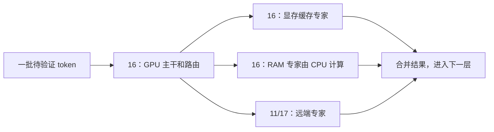

# 双机推理优化计划

状态：**本次优化尝试失败，已按用户要求终止并回滚相关代码。**
第一、第二批没有得到可重复、可采用的性能收益；第三、四批取消，不再继续剩余实验。
2026-10-12 恢复本次修改的 11 个已跟踪源码/测试/文档文件，移除新增候选代码、实验工具及独立候选包，
host11 测试二进制恢复优化前备份并核对 SHA256。普通部署配置、系统设置和内存保护余量保持原值。
原始测量和下文计划保留为历史记录；“下一步”“待测”“暂停”等表述不再代表继续工作的安排。
回滚清单、撤销补丁和退役实验代码归档见
[回滚记录](bench/results/2026-10-12-optimize-rollback-133042/rollback.json)。
回滚后 CPU/CUDA/HIP 目标及 SYCL 共享 CPU 池/宿主构建通过，17 项配置、18 项协议、
16 项 native worker 测试通过；完整 SYCL 引擎未复测。测试进程已退出，未提交或推送。

## 测量依据

2026-10-11，Windows，host16：i9-12900HK、RTX 4060 Ti 16 GiB、约 32 GiB RAM；
host11：i7-10700、约 64 GiB RAM。IQ3_S、引擎 0.1.42、MTP、远端汇总，有线 LAN。
诊断请求 9 生成 1113 token，decode 72.385 秒，约 15.4 tok/s；18278 个任务逐个对齐两端日志。

| 项目 | 累计秒 |
| --- | ---: |
| 主机实际等待远端 | 59.365 |
| 远端专家计算 | 33.133 |
| 远端解析、准备、校验、汇总、发送 | 2.373 |
| 通信及调度剩余区间 | 23.291 |
| 主机排队 | 0.287 |
| 主机解包 | 0.248 |

等待与往返重叠，不能相加。剩余区间不是纯网络传输时间，也包含调度和日志开销。
这轮开启 GPU profiling 和逐任务日志，是不同 omp 请求中的一轮，不是优化前后性能对照。
证据：`tmp/current-network-timing-analysis.json`、`tmp/dual-host-native/logs/cluster-host16.log`、
host11 `D:/Strata/logs/worker-profile.log`。

## Strata 的核心机制

Strata 利用 MoE 的稀疏计算，把专家权重分层存放，让 GPU 和 CPU 各算适合自己的部分，
再用多 token 验证摊薄权重读取和计算成本。大内存保证专家权重可读，小显卡承担主干和热门专家。
机制依据：[引擎说明](docs/DETAILS.md#how-it-works)、[CPU 专家内核](src/kernels/cpu/native_expert.cpp)。

| 机制 | 如何起作用 | 提速时要关注什么 |
| --- | --- | --- |
| MoE 稀疏计算 | 每层 512 个路由专家中，每个 token 选择 10 个；主干和共享专家仍计算 | 模型存储量与每 token 实际计算量不同；10/512 不是整个模型的活跃参数比例 |
| RAM/VRAM 分层 | GPU 保存主干及缓存专家；CPU 直接计算 RAM 中的其他专家，也可按配置把部分 miss 交给 GPU 经 PCIe 计算 | 专家实际驻留、GPU 命中率，以及 RAM/PCIe 读取与计算速度 |
| 量化及专用内核 | 减少权重字节数，用 AVX2/AVX-512 等内核处理量化权重 | 位数更低不一定更快；权重解码、点积和质量都要测 |
| 多 token 专家计算 | 多个待验证 token 使用同一专家时复用权重读取和解码 | 每个专家实际服务几个 token，不能只看窗口的总 token 数 |
| MTP 和 prompt lookup | 提出候选，再由完整模型验证，一次遍历产出多个有效 token | 每窗口有效产出与耗时；扩大窗口可能同时增加计算成本 |

正常运行时应尽量让专家权重驻留在 RAM/VRAM，减少 SSD 上的反复权重读取。
RAM 容量解决“能否驻留”，之后的速度由实际读取、内核、缓存命中和分支等待决定。
host11 已完整驻留专家，继续增加其 RAM 容量本身不能推导出 decode 加速。
模型的混合注意力和 KV 管理也影响长上下文开销；上下文、KV、MTP 和临时缓冲区会占用
可供专家缓存使用的空间，因此要看实际分配，而不是只看显卡标称容量。

当前分工可以这样理解；host16 RAM 分支已存在，10 月 11 日该轮实际缓存为 0；
10 月 12 日独立测试已分配 1 GiB，但本地分担的性能与输出验收未通过：

其中 host17 是后续候选，尚未加入本次双机验收。下一层需要本层结果，最慢的计算/通信
分支可能限制整层速度；网络专家扩展增加并行资源，也增加逐层往返和激活/结果传输。

统一评估指标是：**decode tok/s ≈ 每个验证窗口实际输出 token 数 / 窗口耗时（秒）**。
已记录请求 7 为约 3.00 token/window、201.36 ms/window，对应约 14.9 tok/s。
应同时减少窗口耗时、提高有效产出；CPU、GPU 和网络计时存在重叠，不能简单累加。

## 提速方向与硬件扩展条件

以下是优化作用方向，不替代四批实施顺序。第一批排查已收口，当前继续第二批诊断和复测；
第三、四批候选保持暂停，不因新增硬件信息自动切换配置或部署。

| 方向 | 对当前配置的意义 | 所属批次或条件 |
| --- | --- | --- |
| 压缩 host16 的提交占用、验证 CPU 分担 | 已证明本地分支可参与，但本轮没有可采用的收益 | 第一批已收口；后续候选仍保持系统设置和保护余量 |
| 提高有效 GPU 专家命中率 | 把 omp 实际常用的专家留在显存，减少远端工作 | 第三批；测缓存容量及 profile 与实际路由的匹配 |
| 提高 RAM 专家吞吐 | 按 CPU 阶段占比优化权重解码、点积、量化和同步 | 第二、三批；关注 SIMD、内存带宽和持续频率 |
| 减少远端往返和大权重搬运 | 避免多节点通信和外置 GPU 权重上传抵消计算收益 | 第二、四批；需要正确分工和暖缓存 |
| 提高 MTP 每窗口有效产出 | 摊薄逐层计算与通信，减少每个输出 token 的成本 | 第三批；同时测接受率和窗口耗时 |
| 改进 poll、IOCP、分配和复制 | 改善传输调用、完成通知及长尾 | 第二、四批；最终以完整生成实测判断 |

当前约 82% 的 decode 时间用于等待远端结果。GPU 峰值算力增加只有转化为更少的远端工作、
更高的缓存命中或更短的关键路径，才会提高整轮速度；不能用显卡 TFLOPS 直接估计 tok/s。

### host17：8840HS、32 GiB RAM

用户截图确认 Ryzen 7 8840HS、8 核 16 线程、AVX-512、32 GiB DDR5，DRAM 频率约 2790 MHz
（约 5580 MT/s）；集显为 Radeon 780M，共享系统内存。CPU 架构/指令及内存支持参考
[AMD 8840HS 规格](https://www.amd.com/en/products/processors/laptop/ryzen/8000-series/amd-ryzen-7-8840hs.html)。

先作为 CPU 专家节点测试，确认实际选用的内核和持续吞吐。CPU-Z 的当前频率和 TDP 显示
不能代替持续专家计算测量。集显与 CPU 使用同一套系统内存，暂不假设同时启用会更快。

三机初始分工候选为 host11 约 2/3 专家、host17 约 1/3；按本模型全部专家约 46.84 GiB
估算，分别约 31.2/15.6 GiB 权重。这个分配不是实测最优值，最终应按路由负载和两侧耗时调整。
32 GiB 机器直接对半承担约 23.4 GiB 专家，再加系统和预加载余量，可能放不下。
优先有线连接；两个远端节点各自接收激活并返回汇总，很多层的通信量可能接近翻倍。
加节点不会提高 host16 本机提交额度，本机资源条件仍须单独测量。

若假设远端专家计算关键路径减半且其他耗时不变，诊断请求 9 的预算约为 20 tok/s；
实际会增加通信，因此这只是条件计算，不能作为三机收益预测。尚未在 host17 做实测。

### host17：可选 RX 7600M XT 8 GB 外置显卡

用户可增加 RX 7600M XT，独立 8 GB GDDR6；官方显存带宽最高 288 GB/s，参考
[AMD 显卡规格](https://www.amd.com/en/products/specifications/graphics.html)。项目已有 `gfx1102`
HIP 构建目标，但尚未在这块外置卡上验证设备识别、真实专家内核和完整生成。
构建成功不等于该设备和驱动已通过运行验证，见 [多机说明](docs/MULTI_HOST.md)。

| 使用方式 | 当前实现与取舍 |
| --- | --- |
| 单个 GPU worker | 已有 HIP 路径；缓存 miss 会把 RAM 权重上传 GPU，不会自动交给 CPU 算 |
| CPU/GPU 各一个逻辑 worker、不同端口 | 可以静态分配不同专家；需合计评估 32 GiB RAM、提交额度及额外网络扇出 |
| 单个混合 worker，GPU 算显存命中、CPU 算其他专家 | 当前没有此调度；需要新增代码并验证计算重叠，不能当成现成功能 |

初始 GPU 对照候选：留约 5–6 GiB 专家显存预算，先分配约 10% 专家（权重约 4.7 GiB），
验证暖机后频繁权重上传是否消失，再调整热门专家分配。这些是容量估算和测试起点，尚未验证。
外置连接方式需确认；USB4/雷电连接尤其需要依赖显存驻留，实际传输速度不能用显存带宽代替。
更有潜力的结构性候选是 host17 内部 CPU+独显协同，对 coordinator 保持一个节点，
减少额外网络扇出；是否值得实现须先取得 GPU/CPU 实测，且不跳过当前第一、二批收口。

## 优先级和收益项

| 优先级 | 改动 | 要改善的指标 | 边界 |
| --- | --- | --- | --- |
| P0 | 无 profiling 的固定请求基线 | tok/s、p50/p95 的可比性 | 固定二进制、缓存、线程、MTP；预热后重复 |
| P1 | 验证 host16 的 1 GiB 专家缓存 | 本地 CPU 条目、远端计算和实际等待 | 10 月 11 日提交不足降为 0；12 日已参与，但收益未通过 |
| P1 | 请求头与正文合并发送 | socket 调用、往返及长尾 | 不改变协议和数值 |
| P1 | 需要等待时才 poll | 系统调用、往返及长尾 | 保留部分收发、超时、断连处理 |
| P1 | host11 调用线程绑核、4/6/7 worker 对照 | native_ms、p95 | 调用线程参与计算；不盲目使用 SMT |
| P2 | gate/up、量化、down、同步细分 | 找到 CPU 内核优化目标 | 仅诊断开关启用 |
| P2 | 任务粒度、自旋/休眠对照 | CPU 同步、负载均衡 | 记录 CPU 占用和空闲行为 |
| P2 | 中间量化并行、按格式优化内核 | native_ms | 按细分测量选择；验证数值和输出 |
| P2 | 复用任务及响应缓冲区 | 分配、复制、长尾 | 避免异步缓冲区生命周期错误 |
| P2 | GPU 专家缓存容量及 profile | GPU 命中、远端条目 | 同时考虑 KV/prefill/MTP 显存 |
| P2 | MTP 参数 | 每窗口输出 token / 窗口耗时 | 草稿更多不一定更快；控制输出变化 |
| P3 | 1/2/4 GiB 本地缓存和分担量 | 远端负载、整轮 decode | 旧 4 GiB 测量曾变慢，不能默认扩大 |
| P3 | 可选 IOCP | 异步收发、完成通知、多节点扩展 | 保留原传输后端；逐层依赖不变 |
| P3 | 可选 FP16 通信 | 字节数 | 改变数值/协议；仅质量验证后考虑 |
| P4 | 网络、CPU、内存硬件 | 已确认的硬件限制 | 先测瓶颈；本任务不购买或更换硬件 |

已具备：专家预加载、多 token 专家计算、远端汇总、本机编译、后台 worker 绑核、
TCP_NODELAY、每远端节点独立 I/O 线程。无需重复实现。

假设固定任务量且节省全部进入关键路径：专家计算少 20% 对应约 16.9 tok/s；
通信及调度剩余少 20% 对应约 16.4 tok/s；两项都少 20% 对应约 18.2 tok/s。
这些是预算计算，不是预测或实测结果。

## 四批实施

### 第一批：基线和主机 CPU 分担（排查与对照已收口，候选未通过验收）

- 保存运行配置、二进制 SHA256、提交额度、RAM/VRAM、固定请求和原始样本。
- 提供无 profiling 测量入口；与正在运行的 omp 请求隔离，避免把其他活动算作加速。
- 保持 1 GiB 本地缓存和性能核设置；优先排查引擎自身的提交占用，验证可释放空间。
- 不降低内存余量来强行启用缓存；系统设置与服务切换须记录原值和恢复方法。
- 基线已测：固定短提示词、128K 最大上下文、512-token prefill、256 输出 token，
  关闭 profiling，1 次预热、3 次计入；16.0/14.8/14.5 tok/s，中位数 14.8 tok/s。
  四次输出 token SHA256 相同；小样本且未完全排除其他开发活动，不作为稳定性能结论。
- 1 GiB 分担组失败：配置预算 1024 MiB，但实际 resident RAM=0 GiB、local entries=0。
  驱动在参与检查时明确判失败，未将该组速度变化计为 CPU 分担收益。
- 启动时可用物理 RAM 为 17.46 GiB，可用提交额度为 2.25 GiB，日志报告提交上限约 35.7 GiB。
  完整 1 GiB 缓存加 4 GiB 保留余量、0.25 GiB 安全余量，需要至少 5.25 GiB 可用提交额度。
  因此缓存被主动降为 0；这不等于操作系统绝对无法申请 1 GiB。
- 10 月 11 日尚未取得逐进程、逐驱动和引擎分阶段的提交占用，不能认定约 33.4 GiB 全由 Strata 占用，
  也不能把保持页文件设置理解为无解。当前没有证据保证能原样保持所有配置并腾出约 3 GiB。
- 10 月 11 日安排的排查顺序：记录系统/进程提交、物理 RAM 与 GPU 分配在各启动阶段的变化；
  在独立配置中测试 64K 最大上下文，量化节省额度；查可回收的主机权重/临时缓冲区；
  最后评估 GPU/RAM 缓存配比的取舍。普通配置保留 128K，任何方案均需确认实际缓存和整轮速度。
  前两项已补测，见下文；GPU/RAM 缓存配比仍是后续候选，不阻塞第二批继续工作。
- 页文件调整脚本仅已准备，未执行；用户选择保持系统设置。原有 4 GiB 内存余量不变。
- 2026-10-12 补测 Windows 系统提交、进程私有提交、工作集、内核分页/非分页池及 GPU 使用。
  今日系统提交上限 36.265 GiB，背景占用与昨日不同；未修改系统设置，不把缓存恢复归功于代码。
  128K 下 RAM=0 的 READY 引擎私有提交为 17.272 GiB，生成末 17.673 GiB；
  启动阶段的 pack/MTP/cache/READY 私有提交约 2.745/8.225/14.782/17.272 GiB。
  系统提交从启动前 11.841 增至 READY 30.294 GiB；不能把差额直接归于某个驱动。
- 同 GPU cache 3107 slots，64K 的 READY/生成末引擎私有提交比 128K 少约 0.96–1.02 GiB。
  这是独立配置的容量取舍，不足以单独覆盖昨日约 3 GiB 缺口；普通配置仍保持 128K。
- 今日 128K/64K 都实际分配 1.00 GiB RAM，四次生成累计本地 entries 为 12785/13431。
  全程采样最低可用提交分别为 4.430/5.304 GiB。只证明本轮资源条件下可参与，
  不保证同时运行其他开发负载后仍有 4 GiB 余量。
- 诊断轮自动启用 CPU prompt share，部分输出哈希变化，速度不用于验收。
  后续固定 `STRATA_PREFILL_CPU_SHARE=0`，关闭内存采样，保留每次输出、MTP、GPU 命中及真实缓存。
  证据：[提交占用报告](bench/results/2026-10-12-optimize-memory-101138/README.md)。
- 固定 CPU prompt share=0、关闭诊断采样后，128K 的 0/1 GiB 各 1 次预热、5 次计入：
  decode 中位数 13.743/13.807 tok/s；prompt+decode 中位数 19.986/24.045 秒。
  1 GiB 五次计入累计本地 entries=15201，但输出有三个哈希、MTP/实际路由工作量变化，
  不把约 0.5% 的 decode 中位数差异当作收益。0 GiB 组输出保持同一哈希。
  RAM 预算路径启用 unbuffered file tier，0 GiB 路径保留文件缓存，prompt 中位数 1.331/5.434 秒；
  不默认启用本地分担，不扩展到 2/4 GiB，后续需定位本地输出变化及 prompt 路径代价。
  证据：[固定配置样本](bench/results/2026-10-12-optimize-acceptance-102415/analysis.json)。
- 收口结论：完成内存排查和本地参与验证，没有得到可采用的提速方案；不把候选失败记为优化成功，
  也不因没有收益无限停留在第一批。可以继续第二批，1 GiB 输出变化保留为后续诊断项。
- 证据：[第一批基线](bench/results/2026-10-11-optimize-stage1-223023/baseline/result.json)、
  [未启用缓存的日志](bench/results/2026-10-11-optimize-stage1-223023/local-1g/engine.log)。

### 第二批：传输和 CPU 调度（输出诊断和固定配置复测完成，无可靠收益，剩余分别对照未收口）

- 新增默认关闭的合并发送、按需 poll 和缓冲区复用路径，旧协议保持兼容。
- 新增默认关闭的 worker 调用线程绑核、任务粒度控制，扫描线程数与自旋时间。
- 对原模式、每个单独开关及组合做专家结果、失败路径和性能对照。
- 构建受影响的 CPU/CUDA/HIP 目标；SYCL 无专家网络后端，不声称该后端已验证。
- 已实现默认关闭的合并发送、按需 poll、缓冲区复用、CPU 调用线程绑核、任务粒度控制。
- 默认/fast I/O/IOCP 的 coordinator 协议及错误路径、native worker 配置/协议和真实专家对照通过。
  CPU/CUDA/HIP 构建通过；SYCL 共享 CPU 池及宿主通过，完整引擎有下文记录的既有错误。
- 完整生成初测：host16/host11 使用同一候选构建、128K 最大上下文、512-token prefill、
  本地 RAM 预算 0、远端汇总、MTP spec 4；每组 1 次预热、3 次计入，每次 256 输出 token。

| 配置 | 三个计入样本 tok/s | 中位数 tok/s | 最长 decode 秒 |
| --- | --- | ---: | ---: |
| 基线 | 16.0 / 16.8 / 13.8 | 16.0 | 18.599 |
| fast I/O | 16.7 / 14.3 / 16.7 | 16.7 | 17.888 |
| 绑核、7 worker | 14.8 / 17.1 / 13.8 | 14.8 | 18.611 |
| 绑核、6 worker | 16.8 / 13.9 / 15.8 | 15.8 | 18.379 |
| 绑核、4 worker | 12.9 / 14.6 / 12.1 | 12.9 | 21.177 |

五组输出 token 哈希相同。fast I/O 的中位数高约 4.4%，但只有三个计入样本、波动明显，
不能认定为稳定加速；没有调整默认启动设置。任务粒度、自旋和组合的完整生成对照尚未完成。
2026-10-12 已完成固定 CPU prompt share=0 的 A1/B1/B2/A2；每会话 1 次预热、5 次计入，
双方相同二进制和 3107 GPU slots，RAM=0。原传输/fast I/O 各 10 次计入，
decode 中位数 15.356/15.886 tok/s（+3.45%），样本 p95 为 19.342/19.297 秒。
原传输计入输出同一哈希；fast I/O 9 次相同、1 次不同，MTP 和实际路由工作量也有变化。
组内范围约 13.2–16.5 tok/s，A1/A2 中位数 16.0/14.8，不能宣称可靠提速或修改默认值。
无 fast I/O 的内存诊断也出现过相同的变化哈希，尚不能归因于传输改变数值。
当时下一步为定位输出稳定性和复测；后续诊断/任务粒度/自旋/单端及部分组合进展见下文。
证据：[ABBA 复测报告](bench/results/2026-10-12-optimize-acceptance-102415/README.md)。
证据：[第二批原始报告](bench/results/2026-10-11-optimize-stage2-225430/summary.json)。

2026-10-12 后续输出诊断：原传输/fast I/O 各 6 次，默认 lookup 下 fast I/O 再现 `2a0faa…`，
首窗口 logits 与原传输逐字节相同；先在位置 62 出现 T=4/T=3 窗口差别，输出从下标 68 分歧。
lookup=0 时两种传输各 6 次的输出、首窗口 logits、87 个窗口、MTP 171/218 和远端工作量完全相同。
普通 decode 4 次自身稳定；非汇总路径 4 次也稳定，但与汇总路径的首窗口 logits 舍入不同。
源码和上游 [#1928](https://github.com/Niko1221/Strata/issues/1928) 指向按耗时选窗口与
按窗口分派 CPU 内核/route tail skip 的组合；本轮未单独区分各自贡献，未修改这些默认策略。
这支持在统一关闭 lookup 的独立配置继续第二批对照，不代表默认路径输出稳定性已经修复。
诊断 trace 速度不作验收，1 GiB 本地缓存的数值分歧仍是未完成项。
证据：[输出稳定性诊断](bench/results/2026-10-12-optimize-output-112050/README.md)。

随后关闭 trace 的固定配置 ABBA：A1/B1/B2/A2 各 1 次预热、5 次计入，seed=42、lookup=0，
原传输/fast I/O decode 中位数 15.542/14.190 tok/s（-8.70%），样本 p95 为 19.0504/19.3932 秒。
24 次生成含预热的输出、MTP 171/218、远端任务/条目和 GPU hits/lookups 全部相同；实际 RAM=0，
3107 GPU slots、两端二进制不变。B1/B2 会话自身明显波动，不宣称一般性回退，但本轮没有可采用的收益。
fast I/O 默认保持关闭；任务粒度、自旋、单端 fast I/O 和短自旋组合已补测，见下文。
证据：[固定配置 ABBA](bench/results/2026-10-12-optimize-stage2-115720/README.md)。

同日剩余候选筛选每组 1 次预热、3 次计入：原模式/tasks16/tasks48/worker spin50/spin500/
仅 coordinator fast/仅 worker fast/两端 fast+spin50 中位数分别为
16.276/13.586/16.469/12.768/14.997/14.004/13.656/12.899 tok/s。
32 次生成含预热的输出和工作量全部一致；tasks48 的约 +1.19% 小于组内波动且未反序复测，
其余中位数低于基线；短自旋降低远端会话 CPU 消耗但未提高吞吐。不采用候选，不改默认。
仍待：固定 lookup 下的绑核 4/6/7 重测、fast+绑核/任务粒度组合，以及传输三个内部动作分别对照。
本轮没有可靠收益，不因此跳进第三、四批；有限短 prompt 筛选不代表一般性性能结论。
证据：[第二批剩余候选筛选](bench/results/2026-10-12-optimize-stage2-123338/README.md)。

### 第三批：计算和任务量（候选提前实现，暂停性能推进）

- 暴露现有 CPU gate/up、量化、down、同步计数，按实际模型格式测量。
- 依据测量实现可选中间量化并行；若阶段占比太小，保留证据、不默认启用。
- 提供 GPU 缓存、MTP、本地缓存大小的有界对照；逐项变更并记录输出/MTP 差异。
- 不在没有测量的情况下改默认内核、缓存策略或模型计算精度。
- 已提前实现可选 CPU 阶段诊断入口、中间量化并行和任务粒度开关；均默认关闭。
- 并行量化及绑核/任务粒度变化的 112 个真实专家案例逐字节相同。
  这仅证明所测案例的数值保持，不能替代完整生成性能验收。
- 暖专家阶段测量脚本已准备，当前没有 `bench/results/2026-10-11-optimize-cpu.json` 报告。
  尚未证明量化阶段值得并行；GPU 缓存、MTP 参数和本地缓存大小的完整对照也未完成。
- 暂停推进；第一批内存排查已收口，等待第二批收口，再依据 CPU 内部计时选择优化。

### 第四批：结构性改造（IOCP 候选提前实现，暂停性能推进）

- 如果前面仍留下明显 socket 等待开销，实现可选 Windows IOCP 传输，协议不变。
- IOCP 处理收发和完成通知，专家计算仍用原计算池；处理部分收发、取消、超时和关闭。
- 比较相同请求的原后端、优化 poll 后端、IOCP 的 p50/p95、CPU 使用和 decode。
- FP16 通信和硬件升级是有条件的后续项；只有字节数瓶颈及质量验证支持时才实施。
- 已提前实现默认关闭的 Windows IOCP 候选，支持部分收发、超时取消后等待完成、断连及重连。
  原协议与原传输路径保留；同一连接每次仍只有一个专家任务，逐层依赖不变。
- coordinator/native worker 的协议及取消/重连测试通过，尚未完成 IOCP 完整生成性能对照。
- 没有推荐或默认启用 IOCP。暂停推进，前三批收口后再测；FP16 通信和硬件升级未实施。

## 验收和记录

每批保存测试命令、运行环境、原始样本、输出哈希/误差、实际设置和未测范围。
普通路径保留；同输入专家结果按原协议逐字节对照，整轮生成还检查 token 数、输出和 MTP。
不同 omp 对话的 tok/s 不算前后对照。profiling 只用于定位，最终速度测量关闭它。
服务发布采用单独目录、完整文件哈希及 Windows 权限继承，保留旧运行包以便恢复。
不提交、推送或发布 PR，除非用户另行要求。

## 实施记录

- 2026-10-11：写入计划，开始第一批。
- 第一批无 profiling 基线：固定短提示词，128K 最大上下文，256 输出 token，1 次预热、3 次计入。
  原运行包的三个计入样本为 16.0/14.8/14.5 tok/s，输出 token SHA256 相同；这是小样本基线。
  `bench/results/2026-10-11-optimize-stage1-223023/` 保留原始记录。
- 1 GiB 对照实际仍为 0 GiB、local entries=0，驱动明确判失败，不将该组当作 CPU 分担收益。
  用户选择保持 Windows 系统设置；不改页文件、不降低内存余量。
  第一批恢复为引擎自身提交占用排查，2/4 GiB 扩展等待 1 GiB 实际参与和收益验证。
- 第二、三、四批候选：`STRATA_NETWORK_FAST_IO`、`STRATA_NETWORK_PIN_HOST`、
  `STRATA_NETWORK_POOL_TASKS`、`STRATA_NETWORK_PARALLEL_QUANT`、`STRATA_NETWORK_CPU_PROFILE`、
  `STRATA_NETWORK_IOCP`；全部默认关闭。
- CPU/CUDA/HIP 候选构建通过；SYCL 共享 CPU 专家池及宿主构建通过。
  SYCL 完整引擎失败于未修改的 `sycl/src/program/generate.cpp` 中 memmem 和 Windows 宏冲突，
  保留 `tmp/optimize-sycl-build.log`，不声称完整 SYCL 引擎通过。
- 默认、fast I/O、IOCP 的真实 CPU coordinator 协议/失败路径对照通过；
  native worker 的 16 项配置/协议测试和 42 个真实模型 Python/native 字节对照通过。
  IOCP 部分帧超时/取消/重连测试通过。
- 并行量化和绑核/任务粒度的 112 个真实模型案例（7 种格式、1/3/4/6 token、共享/独立专家、
  普通/汇总输出）逐字节相同；仅证明这些案例的数值保持，不代表所有生成文本相同。
- host11 原二进制备份于 `D:/Strata/optimization-20261011/original`；候选本机编译通过。
  新开关默认关闭，独立验收端口为 18520。第二批五组完整生成初测已完成，结果如上。
- 顺序纠正：第二批测量期间提前实现了第三、四批候选，未严格遵循逐批验收顺序。
  经用户指出后暂停后续批次；当前没有第三批 CPU 阶段报告或第四批 IOCP 性能报告。
  接下来先回第一批内存排查，再第二批复测收口，不把“代码已写”记作“批次已完成”。
- 本次仅同步计划中的真实进度、失败条件和下一步；未继续修改运行代码、启动测量或修改系统设置。
- 补充引擎稀疏计算、RAM/VRAM 分层、量化内核、多 token 复用和 MTP 机制，以及统一窗口指标。
  记录 host17 CPU 和可选外置 GPU 的资源条件、分工候选及未测范围；保持四批当前顺序。
- 2026-10-12：补做第一批 128K/64K、0/1 GiB 提交占用诊断，1 GiB 两个上下文均实际参与。
  64K 节省约 1 GiB 引擎提交；普通配置保留 128K，未改系统设置或保护余量。
  固定 prompt share=0 的 1 GiB 组没有通过收益/输出验收，2/4 GiB 保持暂停。
- 完成第二批基线/fast I/O ABBA，各 10 个计入样本；中位数 +3.45%，但输出一致性未通过，
  不修改默认开关。保留原始样本、二进制/profile/布局哈希、MTP、命中及 worker 日志。
  17 项 cluster-config 和 9 项候选 DLL 验证通过，Python 编译检查通过。
  本轮只改测量工具及报告，未改引擎源码、部署包，未提交或推送；测试进程已退出。
- 进度口径明确：第一批按“排查与对照完成、候选未通过验收”收口，允许继续第二批；
  第二批下一项为输出稳定性诊断及剩余单项/组合对照，第三、四批性能推进继续暂停。
- 2026-10-12 继续第二批：保存完整输出/首窗口 logits/逐窗口记录，复现分歧并确定固定 lookup=0
  的传输对照配置；原传输/fast I/O 各 6 次诊断稳定，普通 decode/非汇总补测各 4 次自身稳定。
  未修改数值内核或 default lookup/tail skip，1 GiB 本地数值分歧未诊断完成。
- 完成无 trace 固定配置 ABBA 和 8 组调度/单端/短自旋组合筛选，输出/工作量检查通过但无可靠收益。
  修复测量工具 DONE/stderr 同步、精确毫秒、完整输出和两端参数记录；17 项配置、18 项协议、
  1 项捕获回归及 Python 编译检查通过。仅工具/文档变更，未新增引擎构建、提交或推送。
  测试进程退出；第二批仍留上述重测/分别开关项，第三、四批性能推进暂停。
